# Advanced Prompt Engineering Techniques

[← Course index](../../README.md) · [Review prompt basics](../prompt_engineering/README.md)

> **The main idea:** show a useful example, break a task into clear parts, check the answer, and improve the prompt.

## Learning mind map

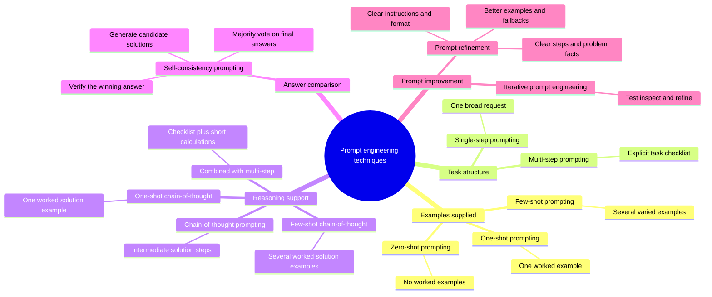

## Jump to a topic

- [1. Zero-shot, one-shot, and few-shot prompting](#1-zero-shot-one-shot-and-few-shot-prompting)
- [2. Single-step and multi-step prompting](#2-single-step-and-multi-step-prompting)
- [3. Chain-of-thought prompting](#3-chain-of-thought-prompting)
  - [Zero-shot chain-of-thought](#zero-shot-chain-of-thought-prompting)
  - [One-shot chain-of-thought](#one-shot-chain-of-thought-prompting)
  - [Few-shot chain-of-thought](#few-shot-chain-of-thought-prompting)
  - [Chain-of-thought versus multi-step](#chain-of-thought-versus-multi-step-prompting)
  - [Combining both](#combining-chain-of-thought-with-multi-step-prompting)
- [4. Self-consistency: compare answers](#4-self-consistency-compare-answers)
- [5. Prompt refinement and iterative prompt engineering](#5-prompt-refinement-and-iterative-prompt-engineering)
- [Choose a technique](#choose-a-technique)
- [Quick revision](#quick-revision)
- [Test your recall](#test-your-recall)

## 1. Zero-shot, one-shot, and few-shot prompting

A **shot** is a completed example: an input paired with its answer.

Examples show both **what to answer** and **how to write it**. They guide the current request; they do not permanently train the model.

### Zero-shot prompting

**Meaning:** give the task without a completed example. Use it when the request is simple and clear.

```text
Prompt: Explain prompt engineering in one sentence for a beginner.
```

The beach-vacation request in [single_step_prompt_to_plan_trip.py](single_step_prompt_to_plan_trip.py) is also zero-shot: it supplies no example answer. **Zero-shot counts examples; single-step describes task structure.** A prompt can be both.

**Memory cue:** **Zero examples → ask directly.**

### One-shot prompting

**Meaning:** give one completed example, followed by a new input. Use it to show the desired rule, style, or format.

Practice: [controlling_output_structure_one_shot.py](controlling_output_structure_one_shot.py).

```text
Example input:  {1, 3, 7, 12, 19}
Example output: {1, 3, 7, 19}

New input:     {3, 5, 11, 12, 16}
Expected:      {3, 5, 11}
```

The example shows the rule—keep odd numbers—and the layout—curly braces with commas. The expected answer above is a manual check, not a recorded model response.

### Few-shot prompting

**Meaning:** give several completed examples before the new input. Use varied examples to show how different cases should be handled.

Practice: [sentiment_analysis_with_few_shot.py](sentiment_analysis_with_few_shot.py).

```text
Positive review →  1
Negative review → -1
New review      → model predicts the label
```

A fair price given the features suggests a positive label, `1`. The script supplies its examples as **user–assistant message pairs**:

**Choose examples carefully:** cover different cases, keep labels consistent, and include a fallback when none fits. More examples also mean more input tokens.

```text
User: example input A    → Assistant: correct answer A
User: example input B    → Assistant: correct answer B
User: new input         → Model supplies the next answer
```

**Memory cue:** **Shots show the pattern.**

## 2. Single-step and multi-step prompting

**Single-step prompting:** give one broad request, such as “Help me plan a beach vacation.”

**Multi-step prompting:** list the tasks to complete, such as choosing locations, accommodation, activities, and pros and cons.

Practice: [single_step_prompt_to_plan_trip.py](single_step_prompt_to_plan_trip.py) → [multi_step_prompt_to_plan_trip.py](multi_step_prompt_to_plan_trip.py).

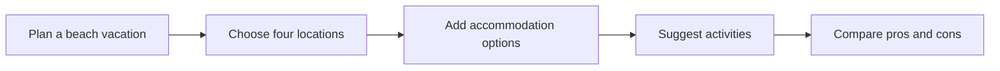

The first script gives the broad task. The second adds a checklist for each location, making missing parts easier to spot. Both send **one API request**; multiple steps do not automatically mean multiple calls.

Multi-step prompts help with both **tasks done in order**, such as introducing a destination before describing a trip, and **tasks needing several checks**, such as reviewing code.

### Use the same idea for code review

Practice: [analyze_solution_correctness.py](analyze_solution_correctness.py).

The requested checks are:

1. Is the Python syntax valid?
2. Does the function accept exactly two inputs?
3. Does it return one output?

The supplied rectangle function accepts `length` and `width` and returns their product. These checks cover its basic shape, not every possible input or edge case.

> **Important detail in the current script:** `prompt` is a normal triple-quoted string, so `{code}` is sent literally. To insert the function, the string needs an `f` prefix: `prompt = f"""...{code}..."""`. Check the assembled prompt before trusting a review.

**Ask about edge cases too:** “Is this calculator correct?” can miss a problem that “Does division handle zero?” makes clear. Name the checks that matter instead of asking only for yes or no.

**Memory cue:** **Steps tell the model what to cover.** A model's review should support real code checks, not replace them.

## 3. Chain-of-thought prompting

The exercises call this **chain-of-thought prompting**: asking for intermediate steps, or showing a worked example before a new problem. For revision, focus on a **short, checkable calculation and final answer**. A written explanation can still contain errors.

### The basic flow

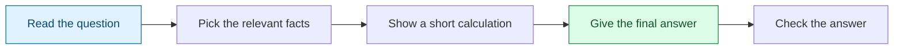

**Read → calculate → answer → check.** These diagrams show checkable worked solutions, not a view into the model's internal thinking.

### Zero-shot chain-of-thought prompting

Give the problem and ask for a solution with intermediate steps, without supplying a worked example. For a small arithmetic task, a brief calculation is enough.

```text
My friend is 20. His father is twice his age.
How old will his father be in 10 years?
Give a short calculation and the final answer.
```

Practice: [reasoning_chain_of_thought.py](reasoning_chain_of_thought.py).

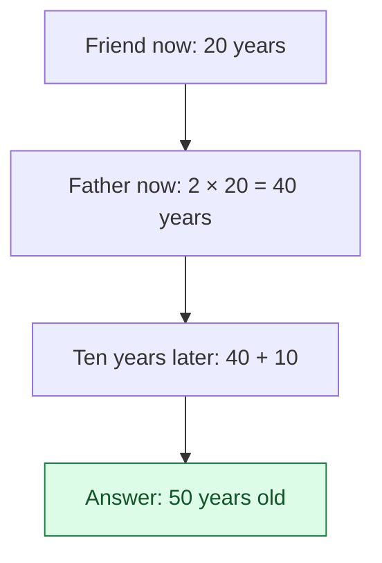

**Check:** double the friend's age now, then add ten to the father's age. Do not double the friend's future age.

### One-shot chain-of-thought prompting

Show one example containing both the calculation and answer. Then give a new problem that uses the same method.

Practice: [one_shot_chain_of_thought_prompts.py](one_shot_chain_of_thought_prompts.py).

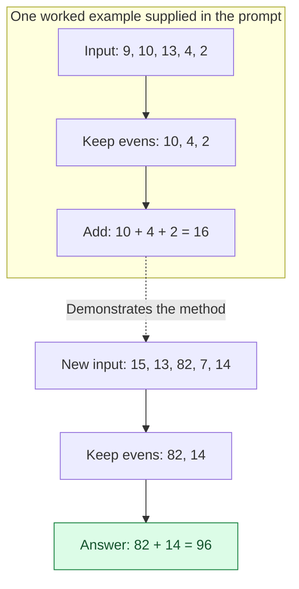

This combines **one-shot prompting** with a short worked solution: select the relevant numbers, then add them. The dotted arrow means the example guides the method; its answer is not reused.

### Few-shot chain-of-thought prompting

Show several worked examples before the new question. Each example should show the useful calculation and final answer, with consistent formatting.

```text
Example 1: Sum even numbers in {2, 5, 8}.
Solution:  2 + 8 = 10.

Example 2: Sum even numbers in {3, 4, 6}.
Solution:  4 + 6 = 10.

New task: Sum even numbers in {7, 10, 12}.
```

Manual check: `10 + 12 = 22`. This is an extra learning example; the existing even-number script supplies one worked example.

### Zero-shot, one-shot, and few-shot at a glance

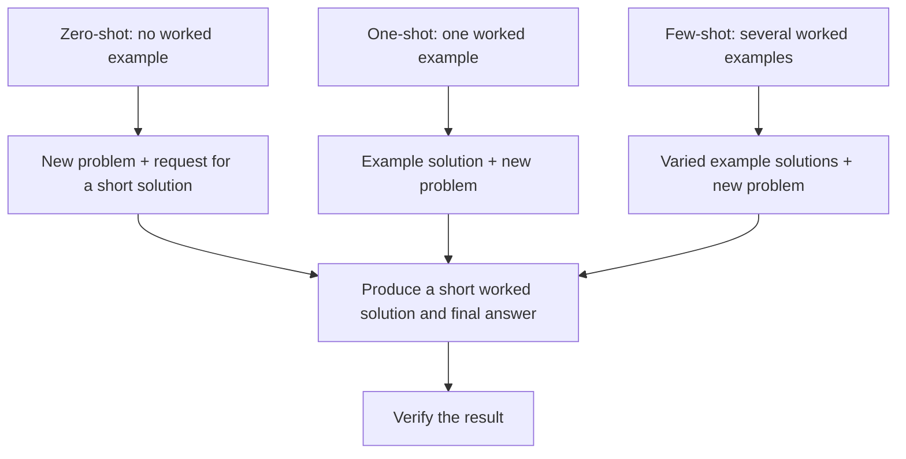

**What changes?** The number of supplied examples. **What stays the same?** The goal of a clear, checkable solution.

### Chain-of-thought versus multi-step prompting

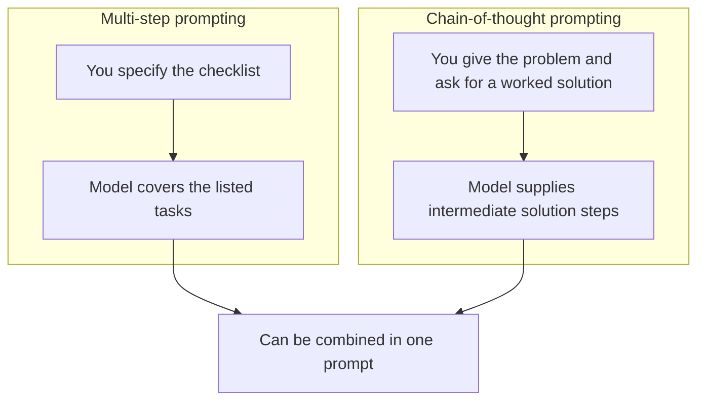

Both can involve steps, but they describe different parts of prompt design. They are not interchangeable names.

### Combining chain-of-thought with multi-step prompting

Use a clear checklist when a problem has several parts, then ask for brief calculations to support each result.

```text
For a store starting with 50 devices, 60% of them phones:
1. Find the starting phone and laptop counts.
2. Subtract 3 phones sold and 1 laptop sold.
3. Add 5 phones and 10 laptops received.
4. Return both final counts and check the total.
Show a short calculation for each count.
```

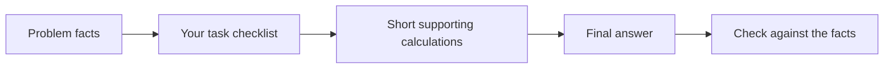

**Memory cue:** **Shots = examples; multi-step = checklist; chain-of-thought = solution steps.** More explanation does not guarantee a better answer; verify the result.

## 4. Self-consistency: compare answers

**Self-consistency prompting** asks for several candidate solutions to the same problem, then uses a **majority vote on their final answers**. Different solution methods may lead to the same result. Agreement can help spot an outlier, but it does not prove correctness.

Practice: [self_consistency_prompts.py](self_consistency_prompts.py).

### Majority vote: what does it mean?

Each candidate contributes one final answer. Count how many candidates agree on the **same complete answer**, not which explanation is longest or sounds most confident.

Illustrative votes for the store problem, not recorded API output:

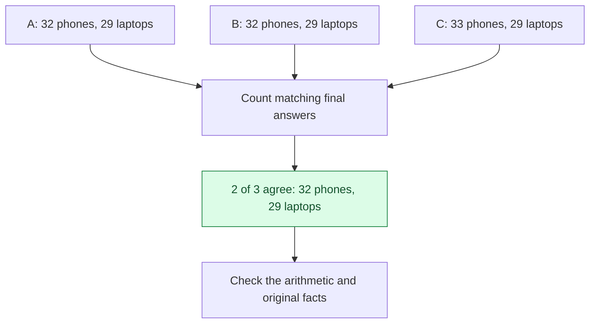

**Majority means more than half.** If all three answers differ, there is no majority. Review the disagreement or collect more candidates instead of declaring a winner. With more candidates, the most common answer may still have less than half the votes; call that the most common answer, not a strict majority.

### Where voting happens in your script

The prompt in [self_consistency_prompts.py](self_consistency_prompts.py) explicitly says:

```text
Compare the three answers and use a majority vote to determine the final answer.
```

The script makes **one model call**, asking it to imagine three experts and compare their answers inside that response. There is **no Python vote counter** and no guarantee that the imagined experts are independent. Repeating a low-variability request may also produce little variety.

A version with voting handled by the application would:

1. Generate several candidate answers.
2. Put each final answer in the same format, such as `(phones, laptops)`.
3. Count matching answers and check whether a majority exists.
4. Verify the chosen answer, or investigate if there is no majority.

**Memory cue:** **Solve several times → compare final answers → count votes → verify.**

### Check the store problem by hand

```text
Start:   50 devices → 60% phones = 30 phones; 20 laptops
Sold:    3 phones and 1 laptop
Added:   5 phones and 10 laptops

Phones:  30 - 3 + 5  = 32
Laptops: 20 - 1 + 10 = 29
Total:   61 devices
```

## 5. Prompt refinement and iterative prompt engineering

**Prompt refinement** means editing a prompt to fix a specific weakness: unclear wording, missing details, poor examples, or an unsuitable answer format.

**Iterative prompt engineering** is the repeated process of writing, testing, checking, and refining. Refinement is the edit; iteration is the whole cycle.

**Memory cue:** **Find the gap → change the prompt → test again.** A longer prompt is not automatically a better prompt.

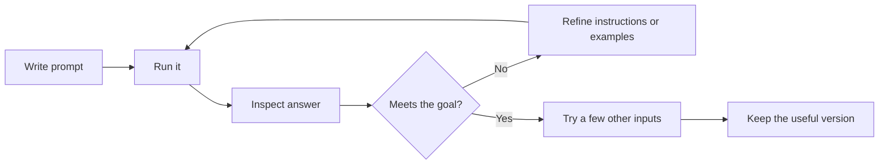

### Start with a clear target

Before editing, say what a good answer must contain. For the language-model exercise, the target is **ten rows, three named columns, and accurate details**. Then inspect what is missing. Fix the cause rather than simply adding “give a better answer.”

### Refine the instructions

Practice: [iterating_prompts.py](iterating_prompts.py).

```text
Before: Give me the top ten pre-trained language models.
After:  Give ten models in a table with exactly these columns:
        Model Name, Release Year, Owning Company.
```

This improves the **shape** of the answer. It does not establish what “top” means or ensure facts are current. For a stronger request, define the ranking rule and date, then verify names, dates, and companies with reliable sources.

A useful refinement ladder for code explanations is:

```text
“Describe this function.”
    ↓ Add a missing detail
“Describe it and name its programming language.”
    ↓ Make the result easy to scan
“Return Description, Language, Inputs, and Output as labelled fields.”
```

For a text-only request, ask for a copyable table or CSV text when that is what you need. Creating an actual spreadsheet file needs file-writing code or a suitable tool.

### Refine the examples

Practice: [iterative_prompt_engineering_few_shot.py](iterative_prompt_engineering_few_shot.py).

The prompt gives happiness, sadness, and fear examples, then adds neutral examples:

```text
Time flies like an arrow                 → no explicit emotion
She opened the door and entered the room → no explicit emotion
They sat and ate their meal              → no explicit emotion
```

The last line is the new input and expected label. Adding neutral examples helps avoid forcing every sentence into an emotion category.

**Watch for words used as figures of speech:** “The political climate was stormy” is not a weather report. A weather classifier needs an `Unknown` example for this case, just as the emotion classifier needs `no explicit emotion`. Teach the meaning of the category, not just a keyword match.

### What to refine for each prompt type

- **Zero-shot or standard prompt:** clarify the action, context, audience, length, and output format.
- **One-shot or few-shot prompt:** correct weak examples, add varied cases, and keep labels consistent. Add a fallback such as `Unknown` where needed.
- **Multi-step prompt:** make each step specific, put steps in a useful order, and add missing checks.
- **Chain-of-thought prompt:** clarify the facts, units, and question. Ask for a short, checkable solution rather than more explanation alone.
- **Self-consistency prompt:** use the same clear problem for each candidate and define what final answer to compare. If answers disagree, inspect the facts and calculations rather than trusting a vote blindly.

### Check that the change actually helped

1. Change one main thing at a time so you can see its effect.
2. Retry the input that failed, then try other inputs too.
3. Check normal cases, tricky cases, and cases needing the fallback.
4. Confirm that fixing one case did not break an earlier correct case.
5. Keep the useful prompt version and a short note about what improved.

For the emotion exercise, test a clearly happy sentence, a fearful sentence, and a neutral sentence. Success means handling all three well, not just memorizing “They sat and ate their meal.”

If an answer stops halfway, check the token cap before changing the wording. If a factual claim is wrong, check a reliable source; changing the answer format does not verify the facts.

Both iteration scripts contain a refined prompt and make one call. They do not run an automatic refinement loop.

## Choose a technique

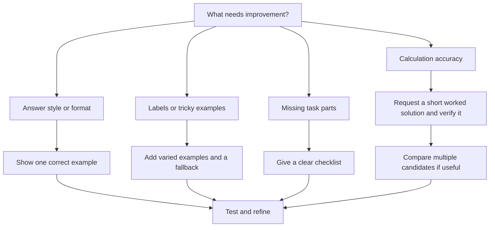

These techniques can work together. For example, give a labelled example, list the checks to perform, and specify the final output fields in the same prompt.

## Quick revision

```text
ZERO-SHOT         No worked example; ask directly.
ONE-SHOT          One example shows a rule or answer format.
FEW-SHOT          Several examples show how labels or patterns work.
MULTI-STEP        A checklist splits a task into clear parts.
CHAIN-OF-THOUGHT  Ask for intermediate solution steps; check the result.
ONE-SHOT CoT      Show one worked solution before the new task.
FEW-SHOT CoT      Show several worked solutions before the new task.
COMBINED          Give a task checklist plus short supporting calculations.
SELF-CONSISTENCY  Generate several solutions; majority-vote on final answers.
MAJORITY VOTE     More than half agree; no majority means investigate further.
REFINEMENT        Edit the weak instructions, examples, steps, or facts.
ITERATION         Repeat write → test → inspect → refine.
```

### Know your helper

[get_response.py](get_response.py) uses `gpt-4o-mini`, one user message, `temperature=0`, and a **100-token completion cap**. It returns `response.choices[0].message.content` and keeps no conversation history.

A four-location plan or three-expert comparison may be cut short by that cap. Some exercise comments mention `max_tokens`; the actual helper uses `max_completion_tokens`. The sentiment script makes its own request and does not set this 100-token cap.

**Before trusting an answer:** check the inserted input, required sections, labels, arithmetic, and whether the answer finished.

## Test your recall

<details>
<summary>1. How are shots different from steps?</summary>

Shots are completed input–answer examples. Steps are instructions naming the parts of a task. One prompt can contain both.

</details>

<details>
<summary>2. What is missing from the code-review prompt?</summary>

The `f` prefix. Without it, `{code}` stays literal instead of being replaced with the function text.

</details>

<details>
<summary>3. What are the answers to the age and even-number exercises?</summary>

The father will be 50. The even numbers 82 and 14 add up to 96.

</details>

<details>
<summary>4. Are the three experts three separate model calls?</summary>

No. The script simulates three experts in one response. Separate candidate calls and a vote in code would be a different implementation.

</details>

<details>
<summary>5. How many devices remain in the store?</summary>

32 phones and 29 laptops: 61 devices in total.

</details>

<details>
<summary>6. Why add neutral examples to the emotion prompt?</summary>

They show that a sentence may contain no clear emotion, so the model should not force an emotion label onto every input.

</details>

<details>
<summary>7. Can a prompt be zero-shot and multi-step at the same time?</summary>

Yes. It can list several task steps while supplying no completed examples. The number of examples and the task structure are separate choices.

</details>

<details>
<summary>8. How do one-shot and few-shot chain-of-thought differ?</summary>

One-shot supplies one worked solution. Few-shot supplies several. Each example includes a useful calculation or explanation as well as the final answer.

</details>

<details>
<summary>9. What is the difference between refinement and iteration?</summary>

Refinement is a change that improves a prompt. Iteration is the repeated cycle of writing, running, checking, and refining it.

</details>

<details>
<summary>10. What should you refine in few-shot, multi-step, and reasoning prompts?</summary>

Few-shot: the examples and labels. Multi-step: the task checklist and order. Reasoning and self-consistency: the problem facts, assumptions, and answer checks.

</details>

<details>
<summary>11. What is majority voting, and what if all three answers differ?</summary>

A majority means more than half the candidates agree on the same final answer. Two matching answers out of three form a majority. If all three differ, review the problem or collect more candidates. Even a majority answer still needs checking.

</details>

## Run an exercise

Follow the [shared setup](../../README.md#shared-setup), then run from the repository root:

```bash
python src/advanced_prompt_engineering_techniques/controlling_output_structure_one_shot.py
```

These scripts make real API calls using your configured key and may incur charges. Direct script execution lets them import the local helper.
