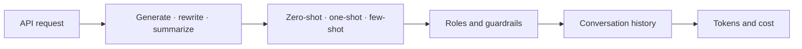
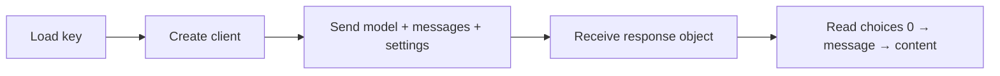
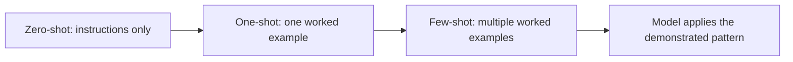
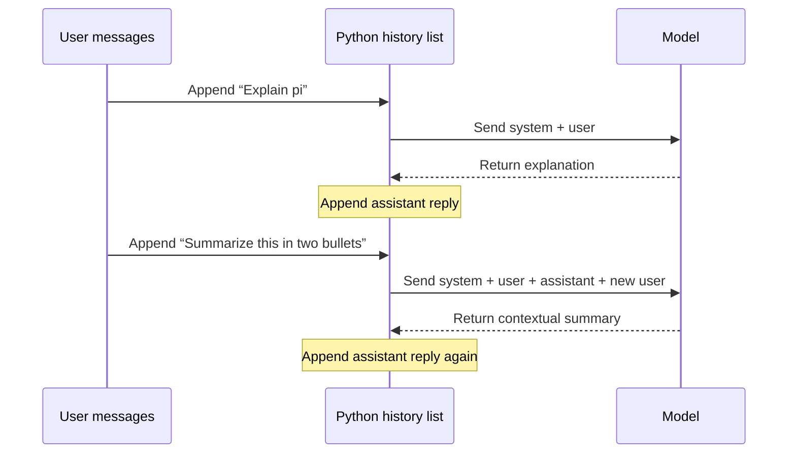

# OpenAI API · Practice & Revision Notes

[← Course index](../../README.md) · [Next: Prompt Engineering with the OpenAI API](../prompt_engineering/README.md)

> Learn to send requests, generate and transform text, guide a model with examples, maintain conversations, and estimate token costs.

## Learning map



## Contents

- [1 · Anatomy of an API request](#1--anatomy-of-an-api-request)
- [2 · Generating, transforming, and summarizing text](#2--generating-transforming-and-summarizing-text)
- [3 · Zero-shot, one-shot, and few-shot prompting](#3--zero-shot-one-shot-and-few-shot-prompting)
- [4 · Roles, examples, and guardrails](#4--roles-examples-and-guardrails)
- [5 · Conversation history and chatbot loops](#5--conversation-history-and-chatbot-loops)
- [6 · Tokens and cost](#6--tokens-and-cost)
- [Quick revision](#quick-revision)
- [Recall questions](#recall-questions)

## Running the exercises

Follow the [shared setup](../../README.md#shared-setup), then run from the repository root:

```bash
python src/openai_api/openai_request.py
python src/openai_api/conversations_with_api/ai_chatbot.py
```

These notes cover the 15 Python exercises in this course folder, including its conversation subfolder. Illustrative outputs are learning examples, not captured API responses.

## 1 · Anatomy of an API request

Practice: [openai_request.py](openai_request.py)

```python
from openai import OpenAI
from dotenv import load_dotenv

load_dotenv()
client = OpenAI()

response = client.chat.completions.create(
    model="gpt-4o-mini",
    messages=[{"role": "user", "content": "Write a polite job-offer acceptance."}],
    max_completion_tokens=100,
)

print(response.choices[0].message.content)
```

This learning example uses a larger output budget than the original exercise's **10 tokens**, which can cut off the reply.



- **`model`** selects the model used by the request.
- **`messages`** contains ordered role/content dictionaries.
- **`max_completion_tokens`** caps the completion budget. A cap is not a requested exact length.
- **`temperature`** controls sampling variability where supported. Lower values tend toward more consistent output; `0` does not guarantee identical results or factual correctness.
- **`response.choices[0].message.content`** accesses the first choice's message text in these exercises.

**Memory hook:** **Load → Client → Request → Extract.**

Parameter support depends on the model. These notes preserve this repository's Chat Completions workflow. See the [official Chat API reference](https://developers.openai.com/api/reference/resources/chat) for request and response details.

## 2 · Generating, transforming, and summarizing text

### Generate: create new content from a brief

- [content_generation.py](content_generation.py): an Italian restaurant slogan. The prompt gives cuisine, atmosphere, positioning, and a short creative output requirement; the budget is 20 tokens.
- [generating_product_description.py](generating_product_description.py): SonicPro headphones. The prompt lists ANC, 40-hour battery life, and a foldable design, then requests benefits, a headline, and a call to action. It uses `temperature=0` and a 400-token cap.

**Remember:** product facts + audience + purpose + format make a useful content brief. Check that generated marketing claims stay grounded in the supplied features.

### Transform: change meaning consistently

[find_and_replace.py](find_and_replace.py) asks the model to replace “car” with “plane” **and adjust the passage**.

```text
Literal replacement: A plane has four wheels and travels on roads.
Semantic rewrite:   A plane is an aircraft used to transport people or cargo by air.
```

The model can adapt related details. For an exact mechanical substitution, Python's `str.replace()` is simpler and predictable. This exercise intentionally asks for a semantic rewrite. Its 30-token cap is small for rewriting the full paragraph.

### Summarize: preserve meaning while reducing length

[text_summarization.py](text_summarization.py) injects a financial passage into an f-string and asks for **two concise bullet points**.

```text
Source passage → select key ideas → compress → two bullets
```

**Check:** Are both bullets supported by the source? Were the main ideas retained? Did the answer finish within the token budget? A summary should not introduce new advice or claims.

**Recall:** generation creates, transformation adapts, summarization compresses.

## 3 · Zero-shot, one-shot, and few-shot prompting

A **shot** is a worked example supplied in the prompt. It is not the number of questions being classified.



### Zero-shot · define the task directly

[zero_shot_prompting_for_reviews.py](zero_shot_prompting_for_reviews.py) provides a sentiment scale and four reviews, without worked classifications.

```text
Task + label definitions + new reviews + required output
```

### One-shot · show one example

[one_shot_prompting.py](one_shot_prompting.py) includes:

```text
Love these! = 5
```

The model uses that example with the stated negative-to-positive scale to classify the remaining reviews.

### Few-shot · show several examples

[few_shot_prompting.py](few_shot_prompting.py) includes two completed examples:

```text
Comfortable, but not very pretty = 2
Love these! = 5
```

Examples communicate the desired mapping and style. Inconsistent or ambiguous labels can also teach the wrong pattern. More examples add input tokens; their quality matters more than their count.

> **Important repository detail:** the zero-shot script uses **1 = very positive, 5 = very negative**. The one-shot and few-shot scripts use **1 = negative, 5 = positive**. A score of 5 means different things across these files. Compare label definitions before comparing results.

**Memory hook:** **Zero = tell. One = show once. Few = show a pattern.** These are in-context examples, not model training or fine-tuning.

## 4 · Roles, examples, and guardrails

### The three roles practiced here

```text
SYSTEM     → behavior and scope: “You are a concise math tutor.”
USER       → request:            “Explain pi.”
ASSISTANT  → previous reply:     “Pi is the ratio ...”
```

- [system_messages.py](conversations_with_api/system_messages.py): establishes a study planning assistant, then asks for a Japanese learning plan.

### Assistant messages can demonstrate the desired answer

[assistant_messages.py](conversations_with_api/assistant_messages.py) supplies a Portugal question and ideal answer before asking about Greece.

[more_assistant_msgs.py](conversations_with_api/more_assistant_msgs.py) extends that pattern with France, Japan, and India—**four example pairs in total**, including Portugal.

```text
System guidance
  → User example → Assistant example
  → User example → Assistant example
  → New user question → Generated answer
```

This is few-shot prompting expressed as message pairs. The assistant examples guide style and content structure; they are supplied context, not proof that the model verified their facts.

### Guardrails: define the assistant's scope

[adding_guardrails.py](conversations_with_api/adding_guardrails.py) asks the study assistant to accept language-learning requests and return a fixed refusal for other subjects.

Its actual test input is **“Help me learn to DummyLanguage”**. That probes an ambiguous or invented language name, rather than a clearly unrelated subject.

**Useful follow-up tests:** Japanese learning, guitar learning, and an unknown language. A stronger instruction would clarify what to do when the language is unrecognized.

Prompt rules can guide behavior, but they are not guaranteed enforcement. Applications needing strict boundaries should validate behavior in code as well.

## 5 · Conversation history and chatbot loops

Practice: [conversations_history.py](conversations_with_api/conversations_history.py) and [ai_chatbot.py](conversations_with_api/ai_chatbot.py).

For this Chat Completions pattern, your code sends the relevant history with each request. A Python list is the memory used by these exercises.



The essential loop:

```python
messages.append({"role": "user", "content": question})
response = client.chat.completions.create(
    model="gpt-4o-mini", messages=messages, max_completion_tokens=100
)
reply = response.choices[0].message.content
messages.append({"role": "assistant", "content": reply})
```

- The history exercise makes **one request**, appends the response, and prints the list.
- The chatbot loops through **two predefined messages**. It is not yet an interactive `input()` chatbot.
- Both user and assistant turns help interpret follow-ups such as “summarize this.”
- The list exists in memory; restarting the script loses it.
- Longer histories consume more input tokens when resent. A later enhancement could trim or summarize old turns.

**Memory hook:** **Append user → Send history → Append assistant → Repeat.**

## 6 · Tokens and cost

Practice: [calculating_cost.py](calculating_cost.py).

A token is a unit of model input or output; it is not necessarily one word. The exercise reads usage returned by the API:

```python
input_tokens = response.usage.prompt_tokens
output_tokens = response.usage.completion_tokens
total_tokens = response.usage.total_tokens
```

```text
Estimated cost
    = input tokens  × input price per token
    + output tokens × output price per token

Price per token = price per million tokens / 1,000,000
```

The script's hardcoded assumptions are **$0.15 per million input tokens** and **$0.60 per million output tokens**. These are the exercise's constants, not a claim about current pricing. Verify applicable rates before using the estimate for billing.

Hypothetical calculation using those constants:

```text
Input:  1,000 tokens × $0.15 / 1,000,000 = $0.000150
Output:   100 tokens × $0.60 / 1,000,000 = $0.000060
Total:                                  $0.000210
```

The exercise prints actual usage and an estimated cost, not the generated rewrite. It uses a 30-token completion cap. Cost is calculated from **reported usage**, not automatically from the maximum allowed tokens. This simple formula does not account for every possible billing category or discount.

**Memory hook:** **Count actual tokens → apply the matching rates → add input and output.**

## Quick revision

```text
REQUEST     Load environment → client → request → extract text
TEXT TASKS  Generate = create | Transform = adapt | Summarize = compress
SHOTS       Count completed demonstrations, not unanswered questions
ROLES       System = behavior | User = task | Assistant = prior/example answer
HISTORY     Append user → send history → append assistant → repeat
COST        Actual input tokens × rate + actual output tokens × rate
```

**Watch for:** reversed sentiment scales, small completion budgets, missing conversation turns, and growing input usage as history is resent.

## Recall questions

Try answering before expanding each answer.

<details>
<summary>1. Which expression reads the generated text?</summary>

`response.choices[0].message.content` in these exercises.

</details>

<details>
<summary>2. Are four unlabelled reviews four-shot prompting?</summary>

No. Shots count completed demonstrations. Four new reviews with no worked examples are still zero-shot.

</details>

<details>
<summary>3. Why can the same review receive opposite numeric scores across these files?</summary>

The zero-shot file defines 1 as very positive; the one-shot and few-shot files define 5 as positive. The scales differ.

</details>

<details>
<summary>4. What makes “summarize this” work in the chatbot?</summary>

The second request includes the previous user question and assistant explanation, followed by the new user request.

</details>

<details>
<summary>5. Do examples in messages train the model permanently?</summary>

No. They supply in-context demonstrations for that request.

</details>

<details>
<summary>6. Does max_completion_tokens=100 mean you always pay for 100 output tokens?</summary>

No. It sets a cap. The exercise estimates cost from the token usage reported in the response.

</details>
