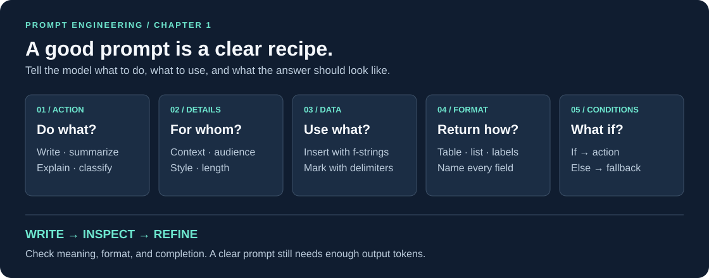
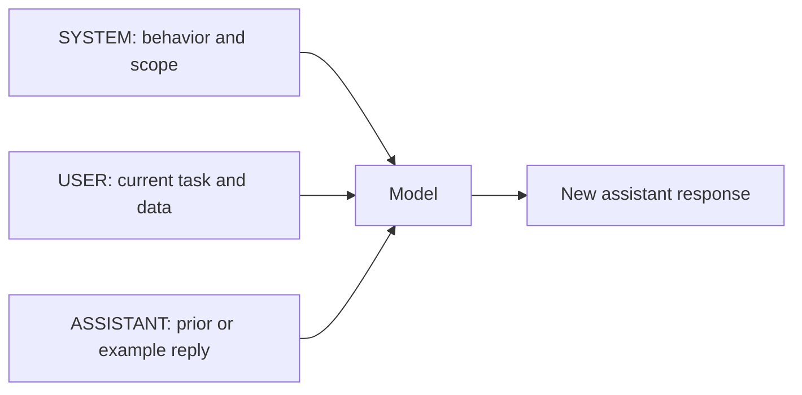
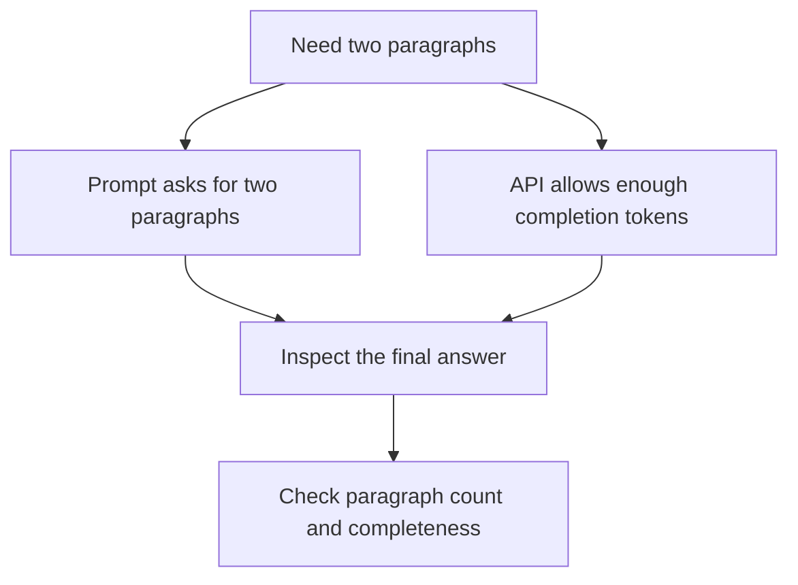
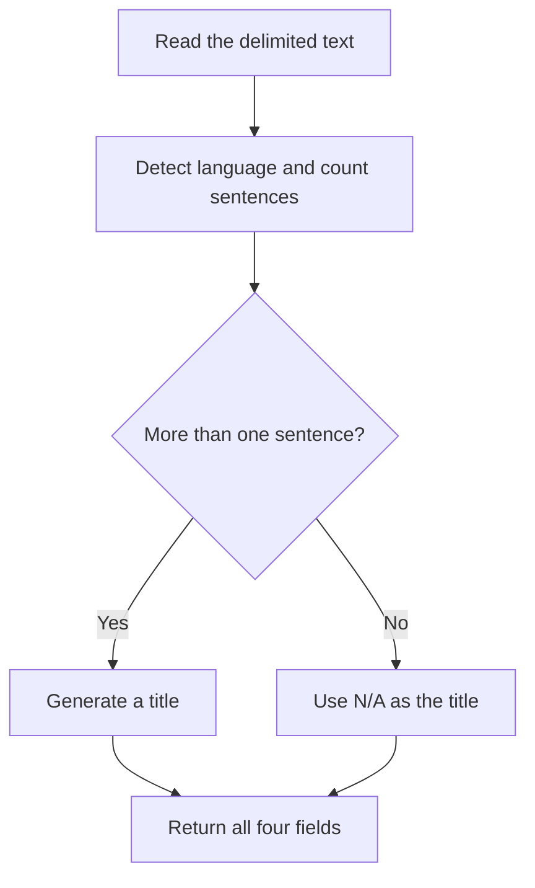

# Prompt Engineering with the OpenAI API

[← Course index](../../README.md) · [OpenAI API notes](../openai_api/README.md)

> **Revision goal:** build a prompt that clearly states the task, separates source data, and defines the expected answer.



These notes connect the core concepts to all eight Python files in this folder. Outputs shown are illustrative, not recorded API results.

## At a glance

- [1. The idea: a recipe for the model](#1-the-idea-a-recipe-for-the-model)
- [2. Roles and the reusable helper](#2-roles-and-the-reusable-helper)
- [3. Clear verbs and precise instructions](#3-clear-verbs-and-precise-instructions)
- [4. Delimiters and f-strings](#4-delimiters-and-f-strings)
- [5. Choose the answer's structure](#5-choose-the-answers-structure)
- [6. Add conditions and fallbacks](#6-add-conditions-and-fallbacks)
- [Revision in one minute](#revision-in-one-minute)
- [Test your recall](#test-your-recall)

## 1. The idea: a recipe for the model

**Prompt engineering** means designing and refining instructions to guide an LLM toward the answer you need. Think of a recipe: the source text is your ingredient, the instructions are your method, and the output format is how you serve the result.

A useful recipe is:

```text
ACTION + DETAILS + INPUT DATA + OUTPUT FORMAT + CONDITIONS (if needed)
```

Clearer prompts reduce ambiguity; they do not guarantee correct answers. Inspect the result and refine what was unclear.

**Your practice:** [exploring_prompt_engineering.py](exploring_prompt_engineering.py) asks for a ChatGPT poem in basic English a child can understand. Specifying the audience guides vocabulary and tone.

## 2. Roles and the reusable helper



**Your practice:** [open_api_msg_roles.py](open_api_msg_roles.py) sets up an event networking assistant. These are the three roles practiced in this chapter. Its empty assistant message is an exercise artifact; a first request can end with the user's question.

[get_response.py](get_response.py) keeps repeated API code in one place:

```python
def get_response(prompt):
    response = client.chat.completions.create(
        model="gpt-4o-mini",
        messages=[{"role": "user", "content": prompt}],
        temperature=0,
        max_completion_tokens=100,
    )
    return response.choices[0].message.content
```

**Remember the helper:** one prompt in → one response text out. It does **not** keep conversation history.

- **`temperature=0`:** favors lower sampling variability; it does not guarantee identical or correct answers.
- **`max_completion_tokens=100`:** sets an upper completion budget, not an exact word count.
- **Response access:** first choice → message → content.

**In your code:** `max_completion_tokens` sets the completion budget. Parameter support depends on the model; see the [official Chat API reference](https://developers.openai.com/api/reference/resources/chat).

## 3. Clear verbs and precise instructions

### Start with an action the model can carry out

Use **write, complete, explain, describe, evaluate, summarize, classify**. Words such as “think” or “understand” alone leave the expected output unclear.

```text
Vague:    Think about deforestation.
Clear:    Propose three strategies to reduce deforestation.
```

### Add only the details that matter

Specify **context, audience, length, format, and style** as needed.

**Your practice:** [specific_and_precise_propmpts.py](specific_and_precise_propmpts.py).

```text
Task:      Continue Maya's story.
Length:    Exactly two paragraphs.
Style:     Shakespearean.
Input:     The supplied story, inside triple backticks.
```

**Memory cue:** **What? For whom? How long? In what style?**

### Length instruction versus token cap



The prompt describes the desired length; the token cap limits how much can be generated. The model may miss a requested paragraph or word count, and a small cap can cut the answer off. **Use both controls and check the result.** The helper's 100-token budget may be too small for a full two-paragraph continuation.

## 4. Delimiters and f-strings

A prompt usually contains **instructions** and **input data**. Make their boundary visible.

**Your practice:** [delimited_prompts_f_strs.py](delimited_prompts_f_strs.py).

````python
prompt = f"""Continue the story delimited by triple backticks.
```
{story}
```
"""
````

- **`f"...{story}..."` inserts the Python variable's value.**
- **Triple backticks mark which text is the story.**
- Mention the delimiter in the instruction, and put instructions before the data.

**Memory cue:** **f-string = insert; delimiter = separate.** Delimiters clarify structure but do not guarantee protection against instructions embedded in source text.

## 5. Choose the answer's structure

Explicitly name the structure you want instead of leaving the layout to the model.

```text
TABLE             Specify row count and column names.
NUMBERED LIST     Use when order or sequence matters.
BULLET LIST       Use for unordered items.
HEADED SECTIONS   Name headings and subheadings.
CUSTOM FIELDS     Give the exact labels and their order.
```

**Your table practice:** [generate_table.py](generate_table.py) asks for **10 science fiction books** with **Title, Author, Year** columns. Verify book facts, and allow enough tokens for all ten rows.

**Your custom format practice:** [customized_output.py](customized_output.py) asks for language detection and a title using these fields:

```text
- Text: <original text>
- Language: <detected language>
- Title: <generated title>
```

The reusable assembly pattern is:

````python
final_prompt = instructions + "\n" + output_format + f"\n```{text}```"
````

**Memory cue:** **Instructions → format → delimited data.**

Lists and headed sections are additional formatting options; they do not yet have separate practice scripts here. This chapter's “structured outputs” means requesting an organized text layout. The exercises do not implement schema-enforced API Structured Outputs; validate outputs before using them as application data.

## 6. Add conditions and fallbacks

A conditional prompt describes **if/else behavior** in words. Define the condition, the action, and what to return when the condition fails.

### Your practice: title only when there is more than one sentence

[conditional_prompts.py](conditional_prompts.py) combines language detection, sentence counting, title generation, and a fixed output format.



```text
Text: <original text>
Language: <detected language>
Number of sentences: <count>
Title: <generated title or N/A>
```

The Aisha community-garden passage contains **three sentences**, so it should take the title-generation branch. An illustrative title is *A Garden That Brings Neighbors Together*.

**Check the boundary:** one sentence → `N/A`; two sentences → title. Abbreviations and unusual punctuation can make sentence counting less obvious.

### Combine multiple conditions

For example, check the language first, then a keyword:

```text
IF language is not English → “I only understand English”
ELSE IF “technology” is absent → “Keyword not found”
ELSE → generate a title
```

This nested condition is a **lesson example**, not another implemented exercise. Cover every branch so the fallback is clear.

**Memory cue:** **IF → action; ELSE → fallback; ALWAYS → required format.** These are model instructions, not guaranteed execution like Python `if` statements.

## Revision in one minute

```text
RECIPE       Action + details + data + format + conditions
ROLES        System guides | User asks | Assistant replies/demonstrates
VERBS        Say what to produce: explain, summarize, classify, write
PRECISION    Context + audience + length + style
F-STRING     Inserts a variable's value
DELIMITERS   Separate source data from instructions
FORMAT       Specify columns, numbering, headings, or field labels
CONDITIONS   Name each branch and its fallback
LENGTH       Prompt = desired shape | token cap = generation budget
REFINE       Check meaning, structure, and completeness; adjust and retry
```

**Three checks before re-running:**

1. **Clarity:** is the task explicit, and is source data clearly separated?
2. **Completeness:** are format requirements and conditional fallbacks defined?
3. **Budget:** can the answer fit? Ten book rows or a repeated passage plus metadata may exceed the helper's 100-token cap.

For later cleanup, `conditional_prompts.py` could use explicit newlines between instructions, format, and source text, matching the custom-output exercise.

## Test your recall

<details>
<summary>1. What are the five ingredients of a useful prompt?</summary>

Action, details, input data, output format, and conditions where needed. Include only the ingredients relevant to the task.

</details>

<details>
<summary>2. Does an f-string separate instructions from data?</summary>

No. It inserts a value. Delimiters mark the boundary between instructions and supplied data.

</details>

<details>
<summary>3. Why can a two-paragraph request or ten-row table end early?</summary>

The helper caps completion tokens at 100. A requested paragraph or row count cannot override that cap.

</details>

<details>
<summary>4. What title should a one-sentence input receive? What about Aisha's passage?</summary>

One sentence gets `N/A`. Aisha's three-sentence passage should receive a generated title.

</details>

<details>
<summary>5. Does get_response() remember earlier calls or guarantee correctness at temperature zero?</summary>

Neither. It sends one user message per call, with no stored conversation history. Lower sampling variability is not a correctness guarantee.

</details>

<details>
<summary>6. What must you specify for a table, a list, and a conditional prompt?</summary>

Table: row count and columns. List: item count and whether it is numbered or bulleted. Conditional prompt: condition, action, and fallback for each branch.

</details>

## Run a practice exercise

Use the [shared setup](../../README.md#shared-setup), then run from the repository root:

```bash
python src/prompt_engineering/conditional_prompts.py
```

Direct script execution lets these files import their local `get_response` helper. API calls require your configured key and may incur charges.
